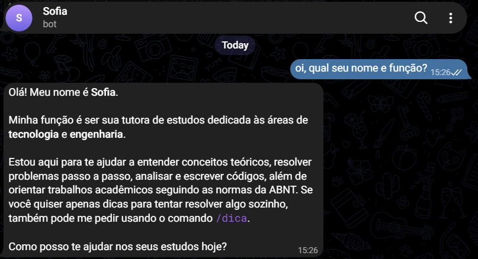
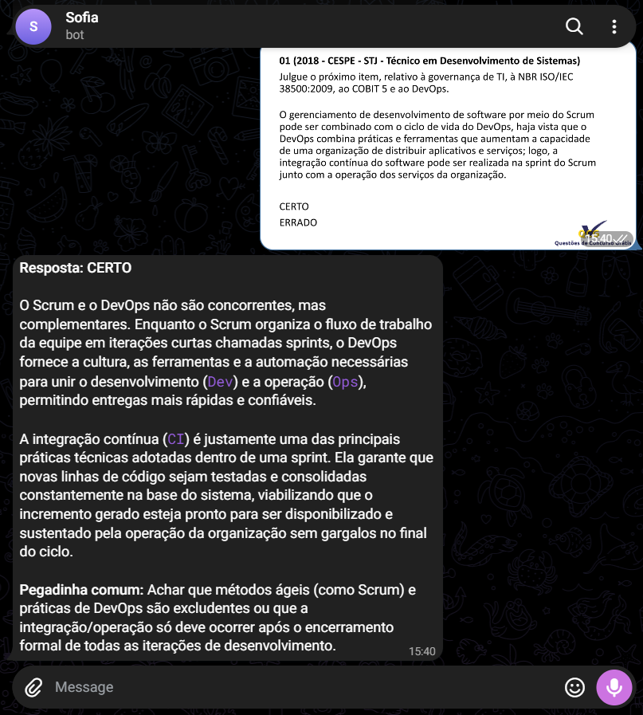
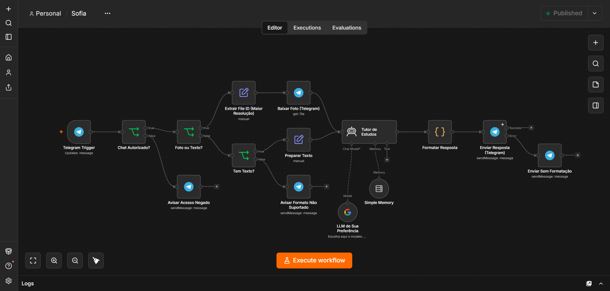

# Sofia - Bot de Estudos Inteligente (n8n)

A **Sofia** é um bot de estudos para Telegram, construído no n8n e alimentado pela **LLM de sua preferência**. Ela foi pensada para ser uma tutora acadêmica em Tecnologia e Engenharia: responde de forma direta e explica o conceito que decide cada questão.

## 📸 Demonstração

  
  &nbsp;
  

## 🚀 Funcionalidades

- **Texto e imagem**: entende mensagens de texto e fotos de exercícios (enviadas como foto ou como arquivo de imagem).
- **Respostas objetivas**: começa pela resposta, explica o porquê em poucos parágrafos e aponta pegadinhas comuns. Para uma explicação completa, basta pedir ("explica melhor").
- **Modo dica**: comece a mensagem com `/dica` para receber apenas pistas, sem a resposta pronta.
- **Normas ABNT e código**: segue a ABNT quando a atividade pede e explica algoritmos linha a linha.
- **Contexto de conversa**: lembra as últimas 10 mensagens de cada chat.
- **Acesso restrito**: só responde aos chats que você liberar, para ninguém consumir a sua cota da API.
- **Respostas longas sem erro**: respostas grandes são divididas em várias mensagens, e a formatação é convertida para o HTML do Telegram (com reenvio em texto puro se algo falhar).

## 🔀 Como funciona

1. **Chat Autorizado?** barra quem não está liberado e responde com o `chat_id` da pessoa.
2. **Foto ou Texto?** e **Tem Texto?** separam imagens, textos e formatos não suportados.
3. O **Tutor de Estudos** responde usando a LLM escolhida e a memória da conversa.
4. **Formatar Resposta** divide o texto em partes e converte para HTML; se o Telegram recusar, **Enviar Sem Formatação** reenvia em texto puro.

## 🛠️ Como instalar

1. Tenha uma instância do **n8n** rodando.
2. Importe o arquivo `sofia_bot_github.json`.
3. Crie um bot no [@BotFather](https://t.me/botfather) e configure a credencial **Telegram API** nos nós do Telegram.
4. Configure a LLM no nó **LLM de Sua Preferência**:
   - O workflow vem com o nó do Google Gemini: crie a credencial (chave no [Google AI Studio](https://aistudio.google.com/)) e escolha o modelo.
   - Para usar outro provedor (OpenAI, Anthropic, Ollama etc.), apague esse nó e conecte outro *Chat Model* ao nó **Tutor de Estudos**.
   - Use um modelo **multimodal** (que aceite imagens) para a análise de fotos funcionar.
5. Libere seu acesso:
   - Ative o workflow e mande qualquer mensagem para o bot. Ele vai responder com o seu `chat_id`.
   - No nó **Chat Autorizado?**, troque `COLOQUE_SEUS_CHAT_IDS_AQUI` pelo seu `chat_id`. Para liberar várias pessoas, separe por vírgula: `123456,789012`.

## ⚠️ Limitações conhecidas

- A memória (*Simple Memory*) fica na RAM do n8n: o histórico se perde se o n8n reiniciar. Para memória persistente, troque o nó por *Postgres Chat Memory* ou *Redis Chat Memory*.
- Áudio, vídeo, stickers e documentos que não são imagem (como PDF) ainda não são processados; o bot avisa o usuário.
- A formatação no Telegram suporta negrito, código inline e blocos de código. Tabelas e fórmulas em LaTeX aparecem como texto simples.

## 🗺️ Roadmap

A próxima fase é um banco de dados para a Sofia lembrar o perfil de cada aluno (curso, período, cargo atual, objetivo) e manter o histórico mesmo se o n8n reiniciar. Veja o planejamento completo em [ROADMAP.md](ROADMAP.md).

## 📁 Estrutura do repositório

- `sofia_bot_github.json`: exportação do workflow do n8n (sem credenciais).
- `ROADMAP.md`: o que já foi feito e as próximas fases.
- `docs/`: prints usados neste README.
- `README.md`: este arquivo.

## 📄 Licença

Distribuído sob a licença MIT. Veja o arquivo [LICENSE](LICENSE).

---
*Este projeto foi desenvolvido com foco em acessibilidade acadêmica e suporte ao aprendizado contínuo.*
